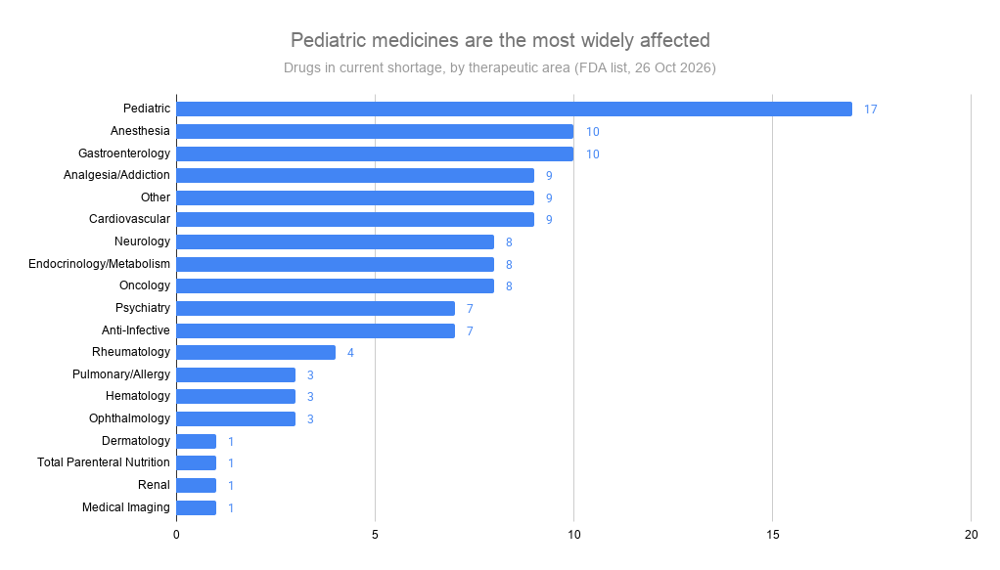
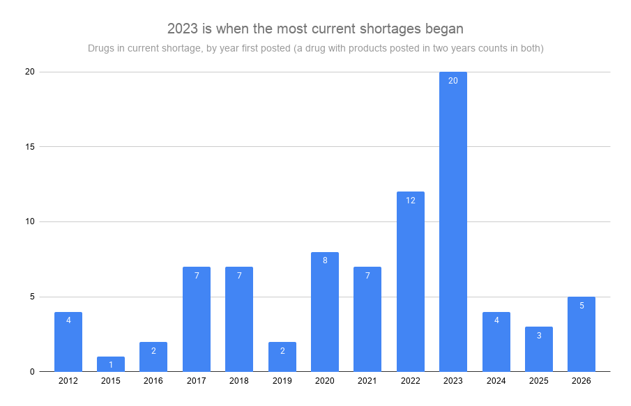
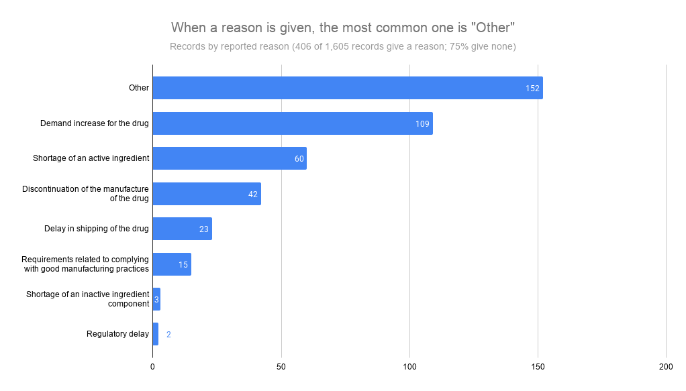
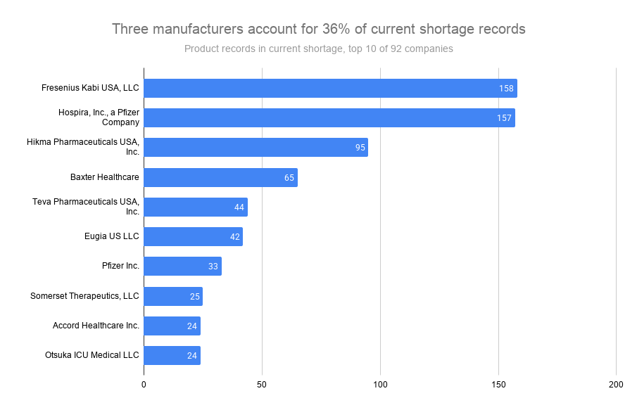
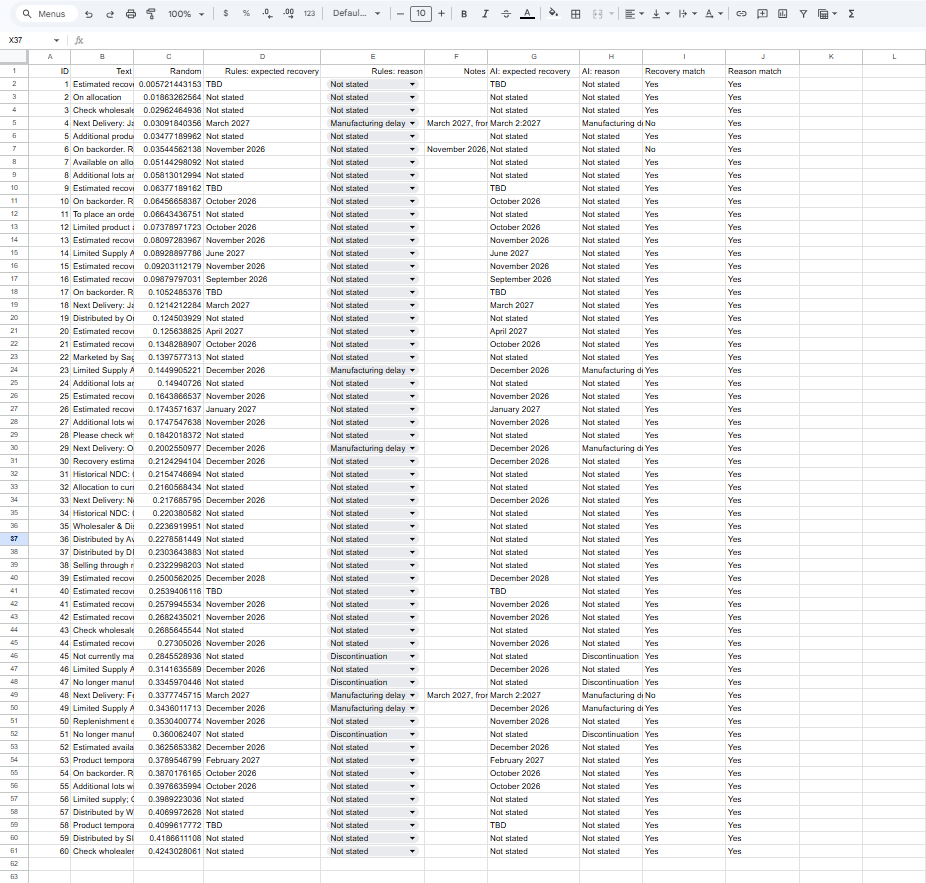

# FDA Drug Shortage Analysis

An analysis of the US FDA drug shortages list in Google Sheets, a check of how accurately a local AI model (Qwen3 4B) extracts recovery dates and shortage reasons from the list's free-text notes, a PostgreSQL database built from the same data and kept up to date with a newer download, and an oncology brief with an Excel scoring model that adds FDA's NDC Directory.

**Data:** FDA Drug Shortages list, downloaded 26 October 2026 ([source](https://www.accessdata.fda.gov/scripts/drugshortages/)), public domain. 1,606 records, 1,605 after removing one exact duplicate. A second download on 29 October 2026 was used to refresh the database.
**Tools:** Google Sheets (QUERY, FILTER, UNIQUE, SPLIT, FLATTEN, COUNTUNIQUEIFS, XLOOKUP, REGEXEXTRACT, pivot table, charts), Python, Ollama with Qwen3 4B, PostgreSQL 18, Excel.

## Headline numbers

| Measure | Value |
|---|---|
| Drugs in current shortage | 69 |
| Current product records (each strength and pack size is a separate record) | 1,141 |
| Median time a current shortage has been on the FDA list | 4.9 years (1,776 days) |
| Current products fully unavailable | 23.0% |
| Records with no reason for the shortage | 74.7% |
| Share of current product records from the top 3 companies | 35.9% |



## Findings

1. **Most current shortages are long-running.** The median current shortage has been listed for 4.9 years, and 4 drugs have been short since 2012. More current shortages began in 2023 (20 drugs) than in any other year.
2. **Pediatric medicines are the most widely affected.** 17 of the 69 drugs in current shortage include Pediatric among their therapeutic areas. Anesthesia has the most product records (351) but covers only 10 drugs, so counting records alone would have hidden the pediatric picture.
3. **The reason field is mostly unusable.** Three in four records give no reason. Of the 406 that do, the most common answer is "Other" (37.4%), followed by increased demand (26.8%) and a shortage of an active ingredient (14.8%).
4. **Supply problems are concentrated.** 92 companies have products in current shortage, but Fresenius Kabi (158 records), Hospira (157) and Hikma (95) account for 36% of them.
5. **A shortage can still show "Available".** Among current shortages, 738 product records are Available, 140 Limited Availability and 263 Unavailable. "Available" means that company can supply that product, even though the drug is short nationally.

| | |
|---|---|
|  |  |



## AI extraction check

The free-text notes often say when supply will return and sometimes why the drug is short. I tested whether a local AI model can extract these two fields reliably.

**Method**

1. Took the 154 distinct notes from current shortages and randomly sampled 60. Distinct notes were used so that one phrase repeated 112 times could not inflate the accuracy.
2. Wrote extraction rules ([labelling_rules.md](documentation/labelling_rules.md)) and turned them into Google Sheets formulas to create reference labels.
3. Gave the same rules to Qwen3 4B, running locally through Ollama ([ai_extract.py](scripts/ai_extract.py)), at temperature 0 with a fixed JSON output format. Each answer was checked against the allowed values, with one retry for invalid output.
4. Compared the two in Sheets and reviewed every disagreement myself.

**Results**

| Field | Agreement with the rules |
|---|---|
| Expected recovery | 57 of 60 (95%); 27 of 30 notes that contain a date |
| Reason stated | 60 of 60 (100%); all 8 notes that state a cause |

All 3 disagreements were AI errors, confirmed by reading the notes:

| ID | Note (shortened) | Rules | Qwen3 | Error |
|---|---|---|---|---|
| 4 | "Next Delivery: January 2027; Estimated Recovery: March 2027 …" | March 2027 | March 2:2027 | Broken date format |
| 48 | "Next Delivery: February 2027; Estimated Recovery: March 2027 …" | March 2027 | March 2:2027 | Broken date format |
| 6 | "On backorder. Recovery: mid-November 2026 …" | November 2026 | Not stated | Missed the date |

**What this shows**

- The output format check caught both broken dates automatically. Without it they would have entered the data unnoticed.
- The missed date passed the format check, because "Not stated" is a valid answer. Only the comparison with a reference caught it, which is why AI output needs checking against a baseline, not just a format check.
- The model handled the same pattern correctly elsewhere ("mid-November 2026" in another note), so its errors are inconsistent rather than systematic.
- 100% on reason is partly because 52 of 60 notes give no cause. Even the free text rarely says why a drug is short.



## PostgreSQL database

The same file was loaded into a normalised PostgreSQL database ([full write-up](database/README.md)):

- **Design:** 6 tables with primary and foreign keys, CHECK rules for status, availability and dates, and a UNIQUE constraint on the natural key (presentation, status, posting date).
- **Load:** PostgreSQL refused the raw file because of blank lines and 4 unescaped inch marks that Google Sheets had accepted, so a script makes a corrected copy for loading. Cleaning is done in SQL inside one transaction.
- **Checks:** 23 data-quality checks. All 15 headline totals match the Google Sheet analysis.
- **Access:** a read-only analyst role that can only use four reporting views, and an admin role, both tested.
- **Indexing:** EXPLAIN ANALYZE before and after. On a 1,000,000-row generated test table, one query went from about 77 ms to under 1 ms; on the real 1,605 records the gain is a fraction of a millisecond.
- **Backup:** pg_dump and pg_restore into a new database, verified with row counts and a checksum of every record.
- **Hypothesis test:** pediatric drugs are not significantly more likely to have a fully unavailable product (Fisher's exact test, p = 0.27).
- **Refresh:** the 29 October download was applied with an audit trigger logging every change: 39 records updated, 2 deleted, and the database matched the new file exactly afterwards.

## Oncology brief

A short consulting-style brief on the 8 oncology drugs in current shortage ([full brief](oncology_brief/README.md)). It combines the shortage list with FDA's NDC Directory (216 marketed products for those drugs) in an Excel scoring model with adjustable weights and two views: patient risk and market entry for a generic manufacturer (fictional client).

- Pentostatin and streptozocin have no generic supplier and rank in the top two under both views. Streptozocin's only marketed product is from a Spanish company, listed as an unapproved drug for use in drug shortage.
- More suppliers does not mean no shortage: dexamethasone sodium phosphate injection has 19 generic approvals and has still been listed for 7.7 years.
- Flurazepam, a sleep medicine tagged Oncology on the FDA list, was kept in the data but excluded from scoring.
- Limits: no sales or volume data, so the model ranks supply signals only.

## Data preparation and validation

All cleaning is done with formulas in a separate `clean` tab, so the raw import is never edited. Every check is listed in [validation_log.md](documentation/validation_log.md). The main steps:

- Imported with the United States locale, because the FDA dates are MM/DD/YYYY. Checked that the first record's date gives month 11.
- Dropped the contact column and 7 empty link and note columns.
- Removed one exact duplicate row; flagged (and kept) 19 products listed twice with different statuses.
- Standardised availability values, including two spelling errors.
- Split multi-area therapeutic categories so each area is counted, and counted distinct drugs as well as product records.

## Limits

- The FDA list holds current and recently resolved shortages. Older shortages that were resolved and removed are not in it, so the start-year chart shows when today's shortages began, not how many shortages started each year.
- US data only.
- The AI check uses a sample of 60 notes and one small model, with rule-based reference labels rather than independent human labels.

## Files

```text
FDA-Drug-Shortage-Analysis/
├── FDA_Drug_Shortages_Analysis.xlsx      Google Sheet exported (raw, clean, analysis, dashboard, AI check tabs)
├── data/
│   ├── raw/fda_drug_shortages_2026-10-26.csv
│   ├── raw/fda_drug_shortages_2026-10-29.csv   newer download, used for the database refresh
│   ├── ai_sample_rules.csv               60 sampled notes with rule-based labels
│   └── ai_sample_qwen3.csv               Qwen3 output, including raw responses
├── scripts/
│   └── ai_extract.py
├── documentation/
│   ├── findings_summary.md
│   ├── labelling_rules.md
│   └── validation_log.md
├── screenshots/
├── database/                             PostgreSQL version: SQL scripts, Python, write-up (see database/README.md)
└── oncology_brief/                       oncology brief, Excel scoring model, NDC filter script (see oncology_brief/README.md)
```

## Author

Aditya Ranjan · [Portfolio](https://beingbrute.github.io) · [LinkedIn](https://www.linkedin.com/in/aditya-ranjan-data) · [GitHub](https://github.com/beingbrute)
