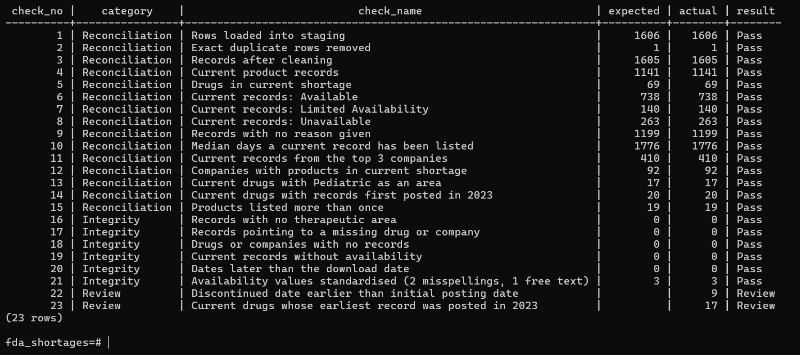
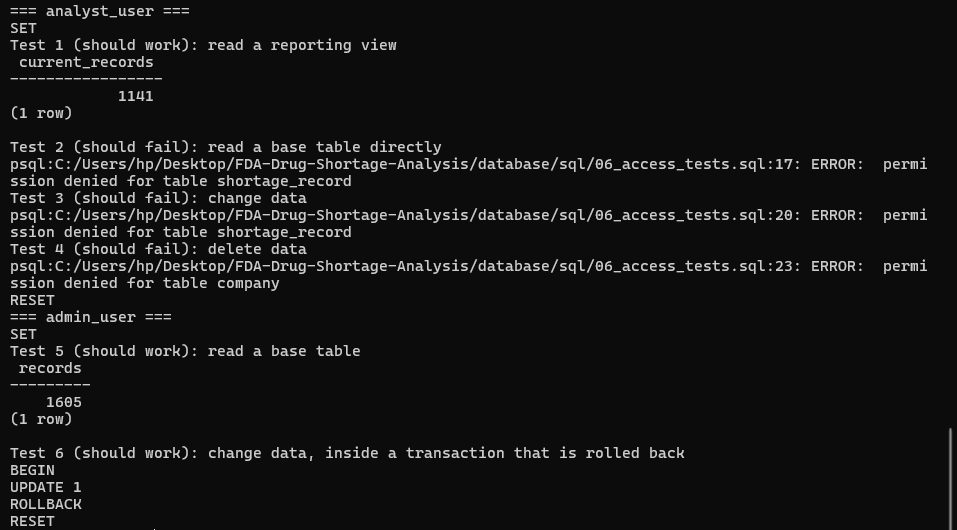
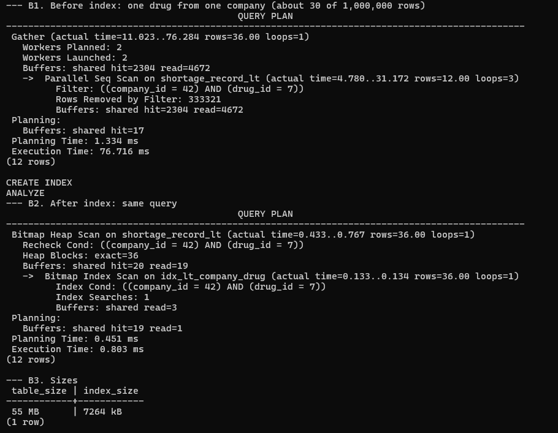
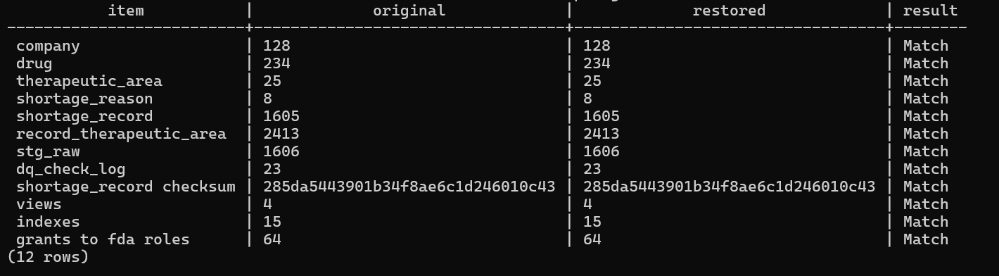
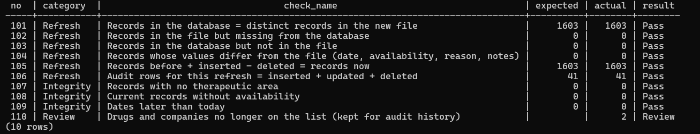

# FDA Drug Shortages: PostgreSQL Database

The FDA drug shortages list from the main project, loaded into a normalised PostgreSQL 18 database and run the way a small production database would be: constraints, data-quality checks, access roles, indexing, a tested backup, and a refresh with an audit trail.

**Data:** FDA Drug Shortages list, downloaded 26 October 2026 (initial load) and 29 October 2026 (refresh).
**Tools:** PostgreSQL 18, psql, pg_dump / pg_restore, Python (psycopg, pandas, SciPy).

## Summary

| Area | What was done | Result |
|---|---|---|
| Design | 6 tables with primary keys, foreign keys, CHECK rules and a natural-key UNIQUE constraint | Every rule was checked against the data before it was added |
| Load | Raw CSV into a text staging table, then cleaned with SQL in one transaction | 1,606 rows → 1,605 records |
| Data quality | 23 checks, logged with a timestamp | All 15 totals match the Google Sheet analysis; all integrity rules pass |
| Access | Read-only analyst role (views only) and admin role | Analyst blocked from base tables and from changing data |
| Indexing | EXPLAIN ANALYZE before and after, on real and generated data | Load test: about 77 ms → under 1 ms on one run |
| Backup | pg_dump, restored into a new database | 12 of 12 comparisons match, including a checksum of every record |
| Statistics | Fisher's exact test from Python | No significant difference (p = 0.27) |
| Refresh | 29 Oct download applied, every change logged by a trigger | 39 updated, 2 deleted, 0 inserted; all post-refresh checks pass |

## Schema

```text
company ────────┐
drug ───────────┼──< shortage_record >──< record_therapeutic_area >── therapeutic_area
shortage_reason ┘
```

| Table | One row per | Rows (26 Oct) |
|---|---|---|
| `company` | company | 128 |
| `drug` | generic drug name | 234 |
| `therapeutic_area` | area | 25 |
| `shortage_reason` | reason | 8 |
| `shortage_record` | product record on the FDA list | 1,605 |
| `record_therapeutic_area` | record and area pair | 2,413 |

Design decisions, each based on checking the data first:

- **No single column identifies a record.** The same product can be listed twice (once Current and once To Be Discontinued, or posted on two dates), so the natural key is presentation + status + initial posting date, enforced with a UNIQUE constraint.
- **Therapeutic areas link to the record, not the drug.** 7 drugs have different areas in different records.
- **Contact info is left out.** 27 companies have more than one number, and it was dropped in the Sheets analysis too.
- **Business rules as CHECK constraints:** Current records must have availability, To Be Discontinued records must have a discontinued date, Resolved records must have a change date, and an update date cannot be earlier than the posting date.

## Loading the data

PostgreSQL refused the raw FDA file for two reasons Google Sheets had accepted without warning:

1. The file starts and ends with a blank line.
2. Four records contain an inch mark that is not escaped inside a quoted CSV value, e.g. `Glass Syringe (20 G x 1 1/2")`.

[`prepare_load_file.py`](scripts/prepare_load_file.py) writes a corrected copy for loading and checks it with a strict CSV parser. The raw file is not changed.

[`03_transform.sql`](sql/03_transform.sql) then trims values, turns empty strings into NULLs, removes the one exact duplicate, splits multi-area categories, converts dates and standardises availability (two misspellings and one free-text value). The original availability text is kept in `availability_raw`. It all runs in one transaction, so a failure leaves nothing half-loaded.

## Data-quality checks

[`04_data_quality_checks.sql`](sql/04_data_quality_checks.sql) runs 23 checks and saves each run to `dq_check_log`.

- **Reconciliation (15):** the database gives the same numbers as the Google Sheet analysis: 1,141 current records, 69 drugs, 738 / 140 / 263 by availability, 1,199 records with no reason, a median of 1,776 days on the list, 410 records from the top 3 companies, and so on. All pass.
- **Integrity (6):** no orphan records, no records without an area, no current records without availability, no dates after the download date. All pass.
- **Review (2):** issues in the FDA data, listed rather than changed:
  - 9 To Be Discontinued records have a discontinued date earlier than the date the FDA posted them (Felodipine and Ivabradine products). Most likely the company stopped making them before the FDA listed them.
  - The main project reports 20 drugs for 2023, counting every drug with any current record first posted that year. Counting each drug once, by its earliest record, gives 17. 2023 is the top year either way.



## Access control

[`05_views_and_roles.sql`](sql/05_views_and_roles.sql) creates four reporting views (`v_current_shortages`, `v_drug_summary`, `v_company_summary`, `v_area_summary`) and two group roles. Login users get their permissions through a role, so access is changed in one place.

| Role | Login user | Can do |
|---|---|---|
| `fda_analyst` | `analyst_user` | Read the four views only |
| `fda_admin` | `admin_user` | Read and change all tables; read the audit trail but not edit it |

No passwords are stored in any file. [`06_access_tests.sql`](sql/06_access_tests.sql) confirms the analyst can read a view but gets `permission denied` when reading a base table, updating or deleting, while the admin can change data.



## Indexing

PostgreSQL indexes primary keys automatically but not foreign keys, so [`07_indexing.sql`](sql/07_indexing.sql) adds indexes on the foreign key columns and checks the plans with EXPLAIN ANALYZE.

| Query | Rows | Plan without index | Plan with index | Time (one run) |
|---|---|---|---|---|
| One company's records | 1,605 | Seq Scan | Bitmap Index Scan | 0.68 ms → 0.11 ms |
| `status = 'Current'` (71% of rows) | 1,605 | Seq Scan | Seq Scan: index not used | 0.39 ms |
| One drug from one company | 1,000,000 generated | Parallel Seq Scan | Bitmap Index Scan | 76.7 ms → 0.80 ms |

- At 1,605 records the whole table is 44 pages of 8 kB, so any gain is a fraction of a millisecond.
- An index on `status` is ignored because most rows match, so it was removed: an unused index still slows down every write.
- The 1,000,000-row table is random generated data used only to show the effect at scale, not FDA data. It is deleted at the end of the script. Part of the 77 ms was reading the table from disk, so the gain is not from the index alone.



## Backup and restore

The `fda` schema was backed up with `pg_dump` (custom format), restored into a new database `fda_restore_test` with `pg_restore`, and compared with [`08_verify_restore.sql`](sql/08_verify_restore.sql): row counts for 8 tables, an MD5 checksum of every shortage record, and the number of views, indexes and grants. All 12 comparisons match.

```text
pg_dump -U postgres -d fda_shortages -n fda -F c -f fda_shortages_2026-10-29.dump
createdb -U postgres fda_restore_test
pg_restore -U postgres -d fda_restore_test fda_shortages_2026-10-29.dump
```



## Hypothesis test

**Question:** among the 69 drugs in current shortage, are pediatric drugs more likely than other drugs to have at least one product that is fully unavailable?

[`hypothesis_test.py`](scripts/hypothesis_test.py) connects as `analyst_user` (the analysis only needs the views) and runs Fisher's exact test at the drug level. Product records of the same drug are not independent, so testing 1,141 records would overstate the evidence.

| | At least one unavailable | None unavailable | Share |
|---|---|---|---|
| Pediatric | 16 | 1 | 94% |
| Other | 42 | 10 | 81% |

Odds ratio 3.81, **p = 0.27: no statistically significant difference.** Pediatric drugs are the most widely affected group (17 of 69), but this data does not show they are more often fully unavailable. With 69 drugs, the test can only detect large differences. Full write-up: [hypothesis_test.md](documentation/hypothesis_test.md).

## Refresh and audit trail

[`09_audit_setup.sql`](sql/09_audit_setup.sql) adds a trigger that logs every insert, update and delete on `shortage_record` to `shortage_record_audit`, with the old row, the new row and the columns that changed. Each refresh is recorded in `refresh_log`.

[`10_refresh.sql`](sql/10_refresh.sql) applied the 29 October download in one transaction: records no longer on the list are deleted, changed records are updated, new records are inserted.

| Before | In new file | Inserted | Updated | Deleted |
|---|---|---|---|---|
| 1,605 | 1,603 | 0 | 39 | 2 |

- All 39 updates have a new update date. 9 have new notes, 4 a new reason, 2 a new availability: Dopamine Hydrochloride Injection 400 mg went from Available to Limited Availability, and Furosemide Oral Solution 10 mg from Limited Availability to Available.
- The 2 deleted records are SymlinPen 60 and 120 (To Be Discontinued, first posted 27 October 2025).

[`11_post_refresh_checks.sql`](sql/11_post_refresh_checks.sql) confirms the database now matches the new file exactly: same records, no values that differ, 1,605 + 0 − 2 = 1,603, and 41 audit rows for 41 changes. One drug and one company are no longer on the list; they are kept because the audit trail refers to them.



## How to run

From the project folder, with PostgreSQL 18 installed. In psql, run each file with `\i 'path/to/file.sql'`.

| Step | Command |
|---|---|
| 1 | `CREATE DATABASE fda_shortages;` then `\c fda_shortages` |
| 2 | `\i database/sql/01_create_schema.sql` |
| 3 | `python database/scripts/prepare_load_file.py` |
| 4 | `\i database/sql/02_load_staging.sql`, then `03_transform.sql` |
| 5 | `\i database/sql/04_data_quality_checks.sql` |
| 6 | `\i database/sql/05_views_and_roles.sql`, then set passwords with `\password analyst_user` and `\password admin_user`; `06_access_tests.sql` |
| 7 | `\i database/sql/07_indexing.sql` |
| 8 | Backup and restore commands above, then `\i database/sql/08_verify_restore.sql` |
| 9 | `python database/scripts/hypothesis_test.py` |
| 10 | `\i database/sql/09_audit_setup.sql`; `python database/scripts/prepare_load_file.py data/raw/<new file>.csv`; edit the two marked lines in `10_refresh.sql`, run it, then `11_post_refresh_checks.sql` |

The `\copy` paths in `02_load_staging.sql` and `10_refresh.sql` point to the author's project folder and need changing on another machine. `04_data_quality_checks.sql` reconciles the 26 October load with the Google Sheet, so it is not re-run after a refresh.

## Limits

- 1,605 records is small for a database; the indexing results at scale come from generated data.
- Roles and backups were tested on one local server, not a shared or production one.
- The refresh is run by hand, not on a schedule.

## Files

```text
database/
├── README.md
├── sql/
│   ├── 01_create_schema.sql          tables, keys, constraints
│   ├── 02_load_staging.sql           raw file into a text staging table
│   ├── 03_transform.sql              cleaning and loading the final tables
│   ├── 04_data_quality_checks.sql    23 checks, logged
│   ├── 05_views_and_roles.sql        reporting views, analyst and admin roles
│   ├── 06_access_tests.sql           permission tests
│   ├── 07_indexing.sql               indexes and EXPLAIN ANALYZE
│   ├── 08_verify_restore.sql         original vs restored database
│   ├── 09_audit_setup.sql            audit table and trigger
│   ├── 10_refresh.sql                apply a newer FDA download
│   └── 11_post_refresh_checks.sql    checks after a refresh
├── scripts/
│   ├── prepare_load_file.py          load-ready copy of a raw file
│   └── hypothesis_test.py            Fisher's exact test via the analyst role
├── documentation/
│   └── hypothesis_test.md
└── screenshots/
```
