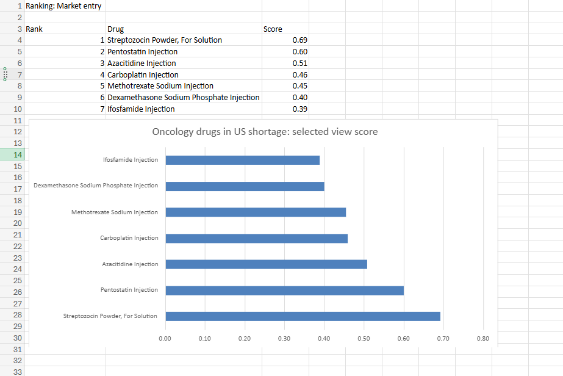

# Oncology Drug Shortages in the US: Supply Exposure and Market-Entry Screen

A short brief and Excel scoring model built on two public FDA sources. Portfolio project: the client below is fictional.

**Data:** FDA Drug Shortages list (downloaded 29 October 2026) and the FDA National Drug Code (NDC) Directory, product file (downloaded 30 October 2026).
**Tools:** Python (pandas) to filter the two files, Excel for the web for the model (COUNTIFS, MINIFS/MAXIFS, XLOOKUP, FILTER, UNIQUE, SORTBY, data validation, chart).

## The question

A generic drug manufacturer (fictional) asks: *of the oncology drugs currently in shortage in the US, which put patients most at risk, and which look like the best candidates for a new supplier?*

## Approach

1. **Shortage side.** From the FDA shortage list, took every current record tagged Oncology: 83 product records across 8 drugs.
2. **Supply side.** From the NDC Directory, took every marketed prescription product for the same 8 drugs in the same form (injection, or capsule for flurazepam): 216 products. Bulk ingredients were left out.
3. **Scope check.** Flurazepam is a sleep medicine, not a cancer drug; the FDA list tags it Oncology. It stays in the data sheet but is marked out of scope and not scored, leaving 7 drugs.
4. **Model.** Each drug is scored 0 to 1 on three measures, scaled across the 7 drugs, then weighted:

| Measure | Source | Patient risk view | Market entry view |
|---|---|---|---|
| Severity: share of shortage records fully unavailable | Shortage list | 50% | 20% |
| Persistence: years since first posted | Shortage list | 25% | 40% |
| Few generic competitors: fewer distinct ANDA approvals scores higher | NDC Directory | 25% | 40% |

The weights sit on an Inputs sheet and a dropdown switches between the two views, so anyone can test their own assumptions.

## Key numbers

| Drug | Shortage records | Unavailable | Years listed | Marketing companies (NDC) | Generic approvals (ANDA) |
|---|---|---|---|---|---|
| Pentostatin Injection | 1 | 100% | 0.2 | 1 | 0 |
| Streptozocin Powder, For Solution | 2 | 50% | 4.3 | 1 | 0 |
| Azacitidine Injection | 9 | 44% | 5.9 | 21 | 12 |
| Carboplatin Injection | 29 | 41% | 3.5 | 11 | 8 |
| Ifosfamide Injection | 8 | 38% | 0.4 | 6 | 3 |
| Methotrexate Sodium Injection | 14 | 29% | 3.6 | 10 | 7 |
| Dexamethasone Sodium Phosphate Injection | 19 | 21% | 7.7 | 25 | 19 |

## Rankings

| Rank | Patient risk | Score | Market entry | Score |
|---|---|---|---|---|
| 1 | Pentostatin | 0.75 | Streptozocin | 0.69 |
| 2 | Streptozocin | 0.57 | Pentostatin | 0.60 |
| 3 | Azacitidine | 0.43 | Azacitidine | 0.51 |
| 4 | Carboplatin | 0.38 | Carboplatin | 0.46 |
| 5 | Ifosfamide | 0.32 | Methotrexate | 0.46 |
| 6 | Methotrexate | 0.32 | Dexamethasone SP | 0.40 |
| 7 | Dexamethasone SP | 0.25 | Ifosfamide | 0.39 |



## Findings

1. **Two drugs have no generic supplier at all, and they top both views.** Pentostatin (used for hairy cell leukaemia) has one marketed product, from Hospira, under the original brand approval. Streptozocin (used for metastatic islet cell carcinoma of the pancreas) has one marketed product, from Esteve, a Spanish company, listed as an "unapproved drug for use in drug shortage". That points to supply being covered from abroad rather than by a US-approved source.
2. **More suppliers does not mean no shortage.** Dexamethasone sodium phosphate injection has 19 generic approvals and 25 marketing companies, yet has been on the list for 7.7 years. Carboplatin has 8 generic approvals and still has 41% of its shortage records fully unavailable. In these markets the problem is reliability of supply, not the number of competitors.
3. **Azacitidine's shortage is spread across the market.** 9 different companies have azacitidine products on the shortage list, 44% of its records are unavailable, and it has been listed for 5.9 years.
4. **Ifosfamide is a new shortage to watch.** First posted in June 2026, it already has 38% of its records unavailable and only 3 generic approvals.

## So what: recommendations for the client

1. **Shortlist streptozocin and pentostatin for a feasibility study.** They have no generic competitor and the clearest unmet supply. Both treat rare cancers, so the next step is to size demand (patient numbers, units, price) and check manufacturing complexity before any decision. FDA prioritises review of generic applications related to a drug shortage, which shortens the route to market.
2. **In crowded markets, compete on reliability, not entry.** For carboplatin and dexamethasone, adding one more approval does little on its own. A supplier with dependable capacity and quality would be more valuable than another listing.
3. **Re-run the screen every month.** The shortage list changes (39 records were updated and 2 removed between 26 and 29 October). The model updates when the two input sheets are replaced, so new shortages such as ifosfamide can be caught early.

## Limits

- **No sales, volume or price data.** The model ranks supply signals only. It cannot say how large any market is; that needs commercial data.
- **Labelers are not all manufacturers.** The NDC Directory lists labelers, which include repackagers and relabelers, so company counts overstate independent manufacturers. Distinct ANDA approvals are used as the competition measure for that reason, but an approval does not prove a product is being made.
- **Small numbers.** Pentostatin's 100% unavailable rests on a single product record.
- **The weights are judgement.** They are shown on the Inputs sheet and can be changed. Pentostatin and streptozocin rank in the top two under both weightings.
- **US only, one point in time.** Shortage list from 29 October 2026, NDC Directory from 30 October 2026.

## Files

```text
oncology_brief/
├── README.md                           this brief
├── oncology_shortage_model.xlsx        Excel model: shortage_onc, ndc_onc, Data, Inputs, Model, Output
├── data/oncology_inputs.xlsx           the two filtered input sheets
├── scripts/prepare_oncology_inputs.py  filters the FDA shortage list and NDC Directory
└── screenshots/
```

The NDC product file (about 40 MB) is not included. Download "NDC database file – Excel version" from the [FDA NDC Directory page](https://www.fda.gov/drugs/drug-approvals-and-databases/national-drug-code-directory) and save it as `data/raw/ndc/ndc_product_2026-10-30.xls` to re-run the script. FDA names it .xls, but it is tab-separated text.

## Sources

- FDA Drug Shortages list: https://www.accessdata.fda.gov/scripts/drugshortages/
- FDA National Drug Code Directory: https://www.fda.gov/drugs/drug-approvals-and-databases/national-drug-code-directory
- Pentostatin indication (Nipent prescribing information): https://www.pfizermedical.com/nipent/indications-usage
- Streptozocin indication (Zanosar prescribing information): https://www.drugs.com/pro/zanosar.html
- FDA, generic drug application prioritisation (30 January 2020): https://www.fda.gov/drugs/drug-alerts-and-statements/fda-revises-generic-drug-application-prioritization-policy-ensure-fairness-applicants-efficiently
